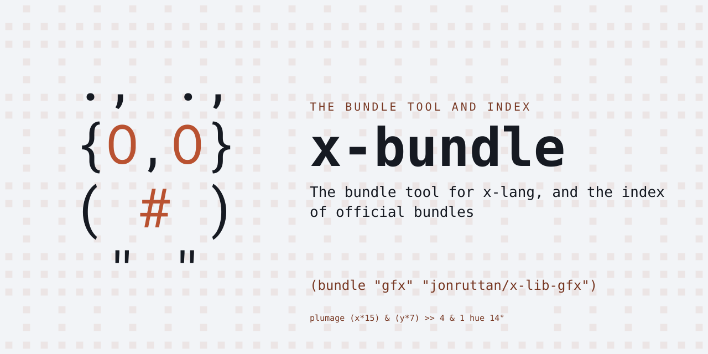

# x-bundle



The bundle tool for [x-lang](https://github.com/jonruttan/x-lang), and the
index of official bundles.

    x -l bundle -- COMMAND [ARG] [OPTIONS]

## Commands

    new NAME      Start a bundle in the directory NAME: its bundle.xon, one
                  module, one spec and a README
    install WHAT  Install a bundle and every bundle it requires. WHAT is a
                  name in the index, OWNER/REPO, the URL of a bundle.pin.xon,
                  or a directory holding a bundle, such as .
    list          List the installed bundles and their versions
    remove NAME   Remove an installed bundle
    check         Check the bundle in this directory: its specs, the linter,
                  its documentation's examples, one meaning a global name

    -d, --dir DIR  The bundles directory, in place of the one this x reads
        --library  With new: a library, a bundle with no entry
    -V, --version  Print the version and exit
    -h, --help     Print this help and exit

```sh
x -l bundle -- new my-app                   # start a bundle in ./my-app
x -l bundle -- install gfx                  # a name the index lists
x -l bundle -- install alice/x-foo          # a repository on github.com
x -l bundle -- install https://example.org/foo/bundle.pin.xon
x -l bundle -- install .                    # the bundle in this directory
x -l bundle -- list
x -l bundle -- remove gfx
x -l bundle -- check                        # the bundle in this directory
```

## What new writes

`new NAME` makes the directory `NAME` with the four files a bundle starts
from:

    NAME/bundle.xon                  its name, (dialect he), the release of this x
    NAME/lib/NAME/run.x              the entry: a main that prints and exits
    NAME/tests/specs/NAME.spec.md    one spec, of what the module says
    NAME/README.md

`--library` starts a library: no `(entry run)`, and the module is
`lib/NAME/NAME.x`. A name is lower-case letters, digits and hyphens, a letter
first. The release declared is the one this x was installed as; an x built
past a release declares that release, and one with no stamp, a checkout,
leaves the row out and says so.

## What install does

A release of a bundle publishes three files: a tarball, its SHA-256, and a
`bundle.pin.xon` naming both. Install finds the pin, and the platform's pin
tool does the rest: the tarball is held to the pin's digest before it is
unpacked, and it replaces an earlier install only once it is whole.

- **A name** is looked up in the index, which gives its repository.
- **`OWNER/REPO`** is a repository on github.com, with or without an index
  row. Its latest release's pin is read.
- **A URL** is the pin itself, on any host.
- **A directory**, what starts with `.` or `/`, holds a bundle: its
  `bundle.xon`, `lib/` and the payload it declares are copied under the name
  the `bundle.xon` declares, with no version stamp, since a directory is no
  release. `list` shows such a bundle with no version, and it meets only a
  requirement that names none.

A bundle that ships more than `lib/` names it in its `bundle.xon`:

```x
(payload "data" "art")
```

Each is a file or directory at the bundle's top. One the directory lacks,
or a path that is not at the top, stops the install before anything is
replaced.

Each `(requires-bundle "NAME" "VERSION" "OWNER/REPO")` row of the installed
bundle's `bundle.xon` is then installed the same way: that release of that
repository, the latest when the row names no version. A row that names no
repository takes the one the index lists under its name, and
`jonruttan/x-NAME` when the index has no such row. A requirement already
installed at the release asked for is left alone.

Two environment variables move where install looks. `X_BUNDLE_INDEX` names
another index, as a URL or a `file://` path. `X_BUNDLE_HOST` replaces
`https://github.com` under an `OWNER/REPO` reference.

## What check does

`check` holds the bundle in the directory it is run from to what the shared
CI holds it to, in four steps, each run whatever the one before it said:

- **One meaning a global name:** no two files define the same global
  differently.
- **Specs:** every `tests/specs/*.spec.md`, on the platform's spec runner.
  The tests that fail are held to `tests/contract/known-failures.txt`, one
  name a line: a failure not in it, and a name in it that passes, both fail
  the step. A bundle with no such file has none recorded.
- **Lint:** the platform's linter, on its structural rules.
- **Documentation examples:** each `(example "IN" "OUT")` in a `(doc ...)`
  form, run and held to what it says.

The checks are the platform's, under its `tests/` and `tools/bundle-kit`,
and are run as they are: a bundle carries no copy of them and no script to
reach them. A bundle with no `tests/harness.x` is given the boot and its
roots; its specs import what they use. The generated harness is written
under `tests/lib/`, which a bundle leaves out of its repository.

## The index

[`index.xon`](index.xon) lists the official bundles, one row each, sorted by
name:

```x
(bundle "gfx" "jonruttan/x-lib-gfx")
```

A name is bare. A reference is `OWNER/REPO` on github.com, or
`DOMAIN/OWNER/REPO`. The index holds no versions, so a new release of a
bundle changes nothing here.

To add a bundle, open a pull request adding its row. The bundle needs a
release that publishes a `bundle.pin.xon`. A bundle needs no row to be
installed by its reference or its pin's URL: the index is the list of bare
names, not a gate.

Every change to this repository, and every week, CI installs each row by its
name with this installer, from the row's latest release
([`tools/index-install.x`](tools/index-install.x)). A row whose repository
publishes no pin, or whose release is another bundle's, fails there.

## Tests

```sh
sh tests/spec-runner.sh
BUNDLE=. sh "$(x --share-dir)/tools/bundle-kit/card.sh"
```

The suite installs from fixture releases under `tests/fixtures`, laid out
under a directory as github.com lays out releases, and reaches no network.

[docs/card.md](docs/card.md) is the card: the commands, the options and what
`new` writes in tables, with its rows and programs run by the platform's
card check above.  `tests/card-run.sh` runs a program: shell lines, in a
directory removed after.
